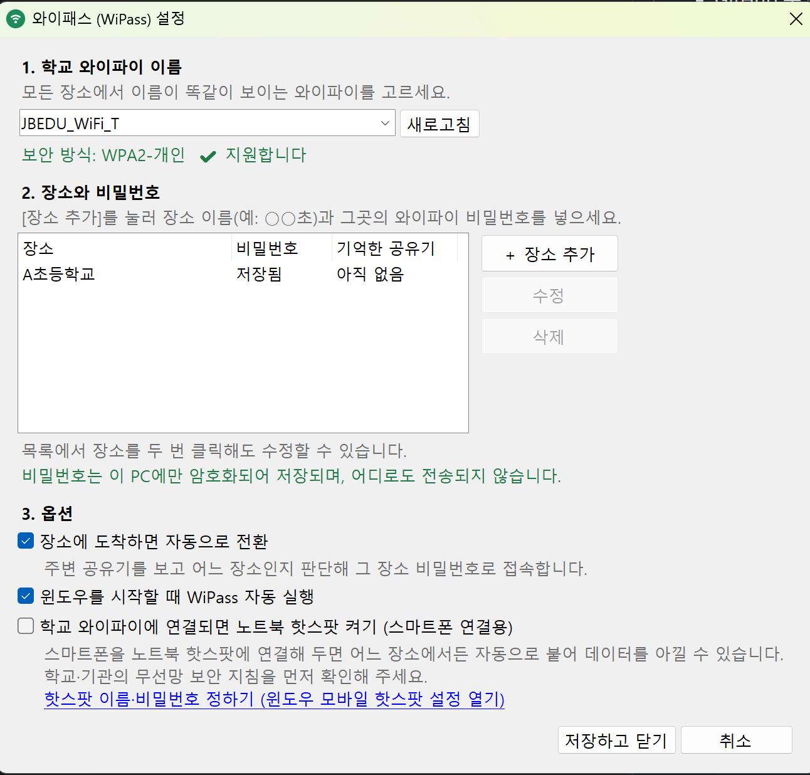
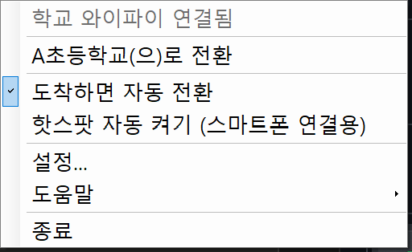

# 와이패스 (WiPass)

**같은 이름 학교 와이파이 자동 전환** — 윈도우 작업표시줄 프로그램

여러 학교(장소)의 와이파이 **이름은 똑같은데 비밀번호만 다를 때**,
학교를 옮길 때마다 "기존 와이파이 삭제 → 비밀번호 다시 입력"을 하고 계셨다면 WiPass가 대신해 드립니다.

> ⚠️ **지금은 시험판(알파)입니다.** 사용해 보시고 [문의 게시판](https://github.com/jomwalimu/wi-pass/issues)에 의견을 남겨 주세요. → [개발 계획](docs/PLAN.md)

<table>
  <tr>
    <td align="center"> 설정 창 — 와이파이 이름, 장소·비밀번호, 옵션</td>
    <td align="center" valign="top"> 작업표시줄 아이콘 메뉴</td>
  </tr>
</table>

<!-- 자동 전환 알림 스크린샷: 추가 예정 (docs/images/auto-switch.png) -->

## 주요 기능

- **도착하면 자동 전환** — 주변 공유기를 보고 어느 장소인지 판단해 그 장소 비밀번호로 접속합니다.
  처음 가는 장소에서는 저장된 비밀번호를 차례로 시도하고, 성공하면 그 장소를 기억합니다.
- **직접 전환** — 작업표시줄 아이콘을 눌러 장소를 고를 수도 있습니다.
- **윈도우 시작 시 자동 실행**
- **노트북 핫스팟 자동 켜기 (선택, 기본 꺼짐)** — 학교 와이파이에 연결되면 윈도우 모바일 핫스팟을 켜서
  스마트폰이 노트북을 통해 인터넷을 쓰게 합니다. 학교·기관의 무선망 보안 지침을 먼저 확인해 주세요.

## 이런 분께 필요합니다

- 2개 이상의 학교·기관을 오가며 **개인 윈도우 노트북**으로 일하는 분
- 장소마다 와이파이 **이름이 같고**, **비밀번호만** 다른 경우 (예: 교육청 공통 무선망)

### 지원하지 않는 경우

- 아이디와 비밀번호를 함께 입력하는 와이파이 (802.1X, 엔터프라이즈 방식)
- 장소마다 와이파이 이름이 다른 경우 (윈도우가 원래 알아서 처리합니다)
- 맥(Mac), 아이폰, 안드로이드 (스마트폰은 노트북 핫스팟 기능으로 연결할 수 있습니다)

---

## 설치

1. [Releases](https://github.com/jomwalimu/wi-pass/releases)에서 최신 **`WiPass-Setup-버전.exe`** 를 내려받아 실행합니다.
   - "Windows의 PC 보호" 파란 창이 뜨면 **[추가 정보] → [실행]** 을 누르세요.
     (전자 서명을 하지 않은 개인 제작 프로그램이라 뜨는 안내입니다)
   - 관리자 권한 없이 지금 사용자에게만 설치됩니다.
2. 설치가 끝나면 WiPass가 실행되고 **처음 설정 창**이 뜹니다.
   - **1. 학교 와이파이 이름**을 고르고
   - **2. [＋ 장소 추가]** 로 장소 이름과 비밀번호를 장소마다 넣고
   - **3. 옵션**을 확인한 뒤 **[저장하고 닫기]**
3. 이제 장소에 도착하면 자동으로 접속합니다.
   작업표시줄 오른쪽(시계 옆, `^` 안쪽)의 와이파이 아이콘을 눌러 직접 고를 수도 있습니다.

> 설치 없이 쓰고 싶다면 `WiPass-버전-portable.zip`을 원하는 폴더(예: `문서\WiPass`)에 풀어 `WiPass.exe`를 실행하세요.

### 꼭 확인할 것: 윈도우 위치 권한

윈도우 11 최신 버전은 위치 권한이 꺼져 있으면 주변 와이파이 정보를 프로그램에 알려 주지 않습니다. (자동 전환에 필요)
**설정 > 개인 정보 및 보안 > 위치**에서 **위치 서비스**와 **데스크톱 앱이 위치에 액세스하도록 허용**을 켜 주세요.
WiPass는 위치를 기록하거나 어디로 보내지 않습니다.

### 업데이트와 제거

- **업데이트**: 새 버전의 설치 파일을 실행하면 됩니다. 장소와 비밀번호는 그대로 유지됩니다.
- **제거**: 윈도우 설정 > 앱 > 설치된 앱에서 **와이패스 (WiPass)** 를 제거합니다.
  제거할 때 저장된 장소·비밀번호도 지울지 물어봅니다.

## 사용법

### 아이콘 색

| 색 | 뜻 |
|---|---|
| 🟢 초록 | 학교 와이파이 연결됨 (마우스를 올리면 장소 이름 표시) |
| 🟡 노랑 | 장소 비밀번호로 접속하는 중 |
| 🔴 빨강 | 접속 실패 — 메뉴에서 장소를 직접 고르거나 비밀번호 확인 |
| ⚪ 회색 | 학교 와이파이 연결 안 됨 / 다른 와이파이 사용 중 |

### 작업표시줄 메뉴

| 메뉴 | 하는 일 |
|---|---|
| ○○(으)로 전환 | 그 장소 비밀번호로 바로 접속 |
| 도착하면 자동 전환 | 자동 전환 켜기/끄기 |
| 핫스팟 자동 켜기 | 학교 와이파이 연결 시 노트북 핫스팟 켜기/끄기 |
| 설정... | 와이파이 이름, 장소·비밀번호, 옵션 |
| 도움말 | 위치 권한·핫스팟 설정 열기, 문의용 진단 정보 저장, 문의하기 |

### 스마트폰을 노트북 핫스팟에 연결하기 (선택)

1. 설정 > **3. 옵션**에서 **노트북 핫스팟 켜기**를 체크합니다.
2. 바로 아래 링크(윈도우 모바일 핫스팟 설정 열기)를 눌러 핫스팟 이름과 비밀번호를 정합니다.
   같은 화면의 **절전**(연결된 장치가 없으면 핫스팟 끄기)은 꺼 두는 것이 좋습니다.
3. 스마트폰에서 그 핫스팟에 한 번만 접속해 두면, 어느 장소에서든 자동으로 붙습니다.
   아이폰은 설정 > 셀룰러 > **Wi-Fi 지원**을 꺼 두면 데이터가 새지 않습니다.

## 자주 묻는 질문

**Q. 처음 가는 학교에서는 조금 오래 걸려요.**
어느 학교인지 아직 모르기 때문에 저장된 비밀번호를 차례로 시도합니다. 한 번 성공하면 그 학교를 기억해서 다음부터는 바로 접속합니다.

**Q. 자동 전환이 안 돼요.**
① 위치 권한이 켜져 있는지 ② 메뉴의 "도착하면 자동 전환"이 체크돼 있는지 ③ 집이나 휴대폰 핫스팟 같은 **다른 와이파이에 이미 연결돼 있지 않은지** 확인해 주세요. 다른 와이파이에 연결돼 있으면 WiPass는 일부러 건드리지 않습니다.

**Q. 학교 비밀번호가 바뀌었어요.**
설정 → 장소를 두 번 클릭 → 새 비밀번호 입력 → [수정] → [저장하고 닫기].

**Q. 비밀번호가 안전한가요?**
이 PC의 윈도우 계정으로만 풀 수 있게 암호화되어 저장되고, 인터넷으로는 아무것도 보내지 않습니다.

**Q. 교육청에서 만든 프로그램인가요?**
아닙니다. 학교 현장에서 일하는 개인이 만들어 무료로 공개한 프로그램입니다.

## 개인정보와 보안

- 비밀번호는 **이 PC의 윈도우 계정으로만 풀 수 있게 암호화**(DPAPI)되어 저장됩니다.
- WiPass는 **인터넷으로 아무 정보도 보내지 않습니다.** (업데이트 확인, 사용 통계도 없음)
- 저장 위치: `%APPDATA%\WiPass` (설정 `settings.json`, 기록 `logs\wipass.log`)

## 문의 · 문제 신고

[Issues](https://github.com/jomwalimu/wi-pass/issues/new/choose)에서 **문제 신고 / 기능 제안 / 사용 문의** 중 하나를 골라 남겨 주세요.
작업표시줄 아이콘 → **도움말 > 문의용 진단 정보 저장**으로 만든 파일을 첨부해 주시면 큰 도움이 됩니다.
⚠️ 게시판은 누구나 볼 수 있으니 **와이파이 비밀번호는 절대 적지 마세요.**

## 제작 · 라이선스

- 제작: **jomwalimu** (전북특별자치도교육청 소속 · 개인 제작, **교육청 공식 프로그램 아님**)
- [MIT 라이선스](LICENSE)로 무료 배포합니다. 어떠한 보증도 하지 않으며, 사용에 따른 책임은 사용자에게 있습니다.
- 교육청 무선망 사용 지침은 각 기관의 안내를 따라 주세요.

## 개발자용

- C# / .NET Framework 4.8 (WinForms), 윈도우 Native Wi-Fi API(`wlanapi.dll`), 핫스팟은 WinRT `NetworkOperatorTetheringManager`
- 빌드: `dotnet build src/WiPass/WiPass.csproj -c Release`
- 설치 파일: Inno Setup 6 (`installer/wipass.iss`)
- `VERSION` 파일의 버전을 올려 main에 반영하면 GitHub Actions가 빌드해서 설치 파일과 압축판을 Releases에 올립니다.
